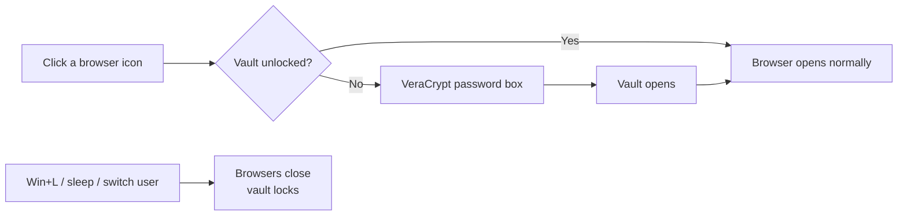

# SecureBrowser

**Password-protect your browser data on a Windows account that several people share.**

The Windows password is known to everyone, but your bookmarks, logins, saved passwords and history stay locked behind a password only you know. Chrome, Edge, Firefox and Brave keep working exactly as before.

> **Early release.** Test it on a non-critical PC first and keep a copy of your vault file.

---

## Why

- Chrome and Edge have no built-in lock for the whole browser.
- Their password protection relies on the Windows sign-in, which doesn't help when the Windows password is shared.
- Edge retired its separate "custom primary password" in 2026.
- Browser-lock extensions are easy to bypass for anyone who can use the Windows account.

The real fix is a separate Windows account for each person. **SecureBrowser is for when that isn't possible.**

---

## How it works

Four standard pieces, put together:

| Piece | Role |
|---|---|
| 🧩 **VeraCrypt** | An encrypted container with its own password, independent of Windows |
| 🧩 **Directory junctions** | Each browser's data folder is moved **unchanged** into the container. A link stays at the original path, so the browser doesn't notice |
| 🧩 **Shortcuts + PowerShell** | Browser icons ask for the password first, then open the browser |
| 🧩 **Task Scheduler** | On lock (Win+L), user switch, sleep and sign-in, the browsers close and the container locks |



---

## Requirements

- Windows 10 or 11
- Windows PowerShell 5.1 (built in)
- [VeraCrypt](https://www.veracrypt.fr). The script offers to install it with `winget` if it's missing
- Free disk space of about 1.5 × the size of your browser data

Supported browsers: **Chrome, Edge, Firefox, Brave**. Opera, Vivaldi and Yandex are not supported.

---

## Install

1. Download `SecureBrowser.ps1`.
2. Sign in to Windows as the **shared** user.
3. Open a **normal** PowerShell window (not "Run as administrator") in the download folder and run:

   ```powershell
   powershell -NoProfile -ExecutionPolicy Bypass -File .\SecureBrowser.ps1
   ```

4. Follow the prompts:
   - Close all browsers and press Enter.
   - Choose a password. Use English characters only; 20 or more is recommended.
   - Type it again in the VeraCrypt window.
   - Wait while the browser data is copied and verified.
   - Open your browsers and check that everything is there.
   - Confirm to delete the old, unprotected copies.

> ⚠️ **If you forget the password, the browser data cannot be recovered.**

---

## Daily use

| You want to… | Do this |
|---|---|
| Open a browser | Click its icon as usual. If it's locked, enter the password |
| Lock | Press **Win+L**, or click **Lock Browsers** on the desktop |
| Unlock without opening a browser | Click **Unlock Browsers** on the desktop |

Tabs come back after unlocking.

---

## Commands

```powershell
.\SecureBrowser.ps1                      # install / update
.\SecureBrowser.ps1 -Action Unlock       # open the vault
.\SecureBrowser.ps1 -Action Lock         # close browsers and lock
.\SecureBrowser.ps1 -Action Cleanup      # delete old unprotected copies
.\SecureBrowser.ps1 -Action Uninstall    # move everything back and remove
```

Setup options:

| Option | Meaning |
|---|---|
| `-DriveLetter R` | Drive letter for the opened vault (default: first free letter from Z down) |
| `-VaultPath <file>` | Where to store the vault (default: `%LOCALAPPDATA%\SecureBrowser\browsers.hc`) |
| `-VaultSize 20G` | Vault size (default: based on your data) |
| `-FileSystem exFAT` | Use if creating an NTFS vault fails |
| `-NoSecureDesktop` | Use if VeraCrypt reports a command-line error |

---

## Uninstall

```powershell
powershell -NoProfile -ExecutionPolicy Bypass -File .\SecureBrowser.ps1 -Action Uninstall
```

This copies all browser data back to its original place, verifies the copy, and removes the scheduled tasks and shortcuts. Once you've checked your browsers, delete the folder `%LOCALAPPDATA%\SecureBrowser`, which contains the vault file.

---

## Recovery without the script

All you need is the vault file and its password.

1. Install VeraCrypt and mount `browsers.hc` (for example on drive `Z:`).
2. Close all browsers, open **Command Prompt**, and run:

```cmd
rmdir "%LOCALAPPDATA%\Google\Chrome\User Data"
robocopy "Z:\Chrome\User Data" "%LOCALAPPDATA%\Google\Chrome\User Data" /E /COPY:DAT

rmdir "%LOCALAPPDATA%\Microsoft\Edge\User Data"
robocopy "Z:\Edge\User Data" "%LOCALAPPDATA%\Microsoft\Edge\User Data" /E /COPY:DAT

rmdir "%APPDATA%\Mozilla\Firefox"
robocopy "Z:\Firefox\Roaming" "%APPDATA%\Mozilla\Firefox" /E /COPY:DAT
rmdir "%LOCALAPPDATA%\Mozilla\Firefox"
robocopy "Z:\Firefox\Local" "%LOCALAPPDATA%\Mozilla\Firefox" /E /COPY:DAT
```

`rmdir` without `/s` removes only the link, never the data.

---

## Limitations

- **Locking closes the browsers.** Unsaved forms and running downloads are interrupted.
- **Opening is about one second slower**, because the icons start a small launcher first.
- **Links opened from other apps** (chat, email) while the vault is locked may not open. Click **Unlock Browsers** first.
- **All-users Start menu shortcuts** are only changed if setup runs with admin rights.
- **The Downloads folder is not protected.** Downloaded files stay in the normal Downloads folder.
- **Chrome and Edge tie saved passwords and logins to the Windows account.** A vault restored on a different Windows installation brings back bookmarks and history, but not those. Turn on browser sync as a second backup.
- **Domain PCs:** Group Policy can block this, for example through the execution policy, BitLocker write protection or roaming AppData. Check with your IT team first.

## Security model

SecureBrowser protects browser data from other people who use the same Windows account, including someone who copies the files. It does **not** protect against someone who installs malware or a keylogger on that account. The VeraCrypt password box runs on a secure desktop, which blocks ordinary user-level keyloggers.

---

## Disclaimer

Provided as-is, without warranty. Test first, back up your vault file, and use at your own risk.

## License

MIT
